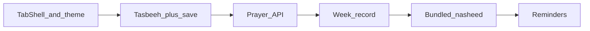

# Faster Islamic Companion v1 plan

## Review of the current spec

[Islamic App/implementation.md](c:\Users\STUDENT\Desktop\Free Claud\Islamic App\implementation.md) is a solid product brief. Keep these as-is:

- Four features: Tasbeeh, Nasheed, Prayer times, Activity record
- Android first, Flutter
- Aladhan API, default city **Peshawar, Pakistan**
- Local save (count and records survive restart)
- Dark mode (system + manual)

What slows a first build in the current doc:

- **Nasheed “add your own files”** needs storage permissions, file picking, and playlist persistence.
- **GitHub-style year heatmap** with past months is extra UI/data work.
- **Dark mode last** forces restyling after screens exist.
- **Activity record before prayer times** delays a useful daily screen.

Your choices for v1: **2–3 bundled royalty-free tracks**, and **this week as 7 colored days** (year heatmap later).

## What will change in the markdown

Rewrite [implementation.md](c:\Users\STUDENT\Desktop\Free Claud\Islamic App\implementation.md) (same file, clearer structure) so it is a build checklist, not only a product idea.

**Scope freeze for v1**

- **Tasbeeh:** big count, tap +1, reset, targets 33 / 99 / 100, haptic + snackbar at target, save with `shared_preferences`.
- **Nasheed:** bundled assets only (2–3 tracks). Play / pause / next. No file picker in v1.
- **Prayer times:** 5 prayers from Aladhan (`timingsByCity`). Default `Peshawar, Pakistan`. End time = next prayer start; Fajr end = Sunrise (already in the API).
- **Activity record:** one row of 7 days (this week). Color by a simple daily score (tasbeeh taps + prayers marked done). Tap a day to mark prayers / Quran pages. No year grid yet.
- **Reminders:** optional toggle; one notification before each prayer (default 15 minutes). If this blocks Android 13+ permission work, ship times first and add reminders next.
- **Theme:** `ThemeMode` (system / light / dark) from the first scaffold so screens are not restyled at the end.

**Explicitly out of v1** (listed in the doc so we do not drift): user-imported audio, GitHub year heatmap, city search UI (hardcode Peshawar; one settings field is enough if time), accounts, Quran reader.

**Faster build order** (this is the main change)

1. Flutter Android project + 4-tab shell + theme
2. Tasbeeh + persist
3. Prayer times (Aladhan) + cache last fetch so the screen still shows if offline
4. Simple week activity row (fed by tasbeeh + prayer checkboxes)
5. Bundled nasheed player (`just_audio`)
6. Prayer reminder notifications
7. Polish (haptics, empty/error states, one-hand layout)

This order gets a tappable app in step 1, a “real” feature in step 2, and internet value in step 3. Audio and notifications stay last because they are the flakiest on Android.

**Suggested stack** (write these into the doc so coding does not pause for package hunting): Flutter, `shared_preferences`, `http`, `just_audio`, `flutter_local_notifications`, `timezone`, `provider` or `ChangeNotifier` (keep state simple; no extra architecture).

**Prayer API shape to lock in the doc:**  
`https://api.aladhan.com/v1/timingsByCity?city=Peshawar&country=Pakistan&method=1`  
(method can be noted as “default; change later”). Map `Fajr`, `Sunrise`, `Dhuhr`, `Asr`, `Maghrib`, `Isha`.

## After you approve this plan

The only file change in the first coding step is rewriting `implementation.md`. We will not create the Flutter app until you say to start building.